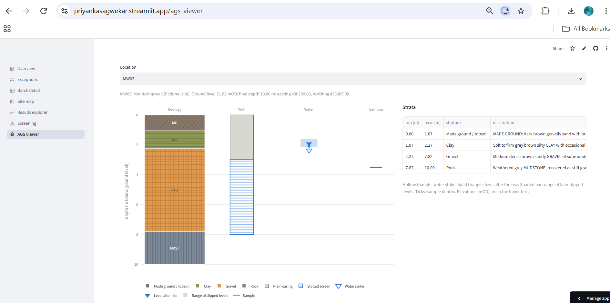

#### Contact Information
* priyankasag10@gmail<!-- -->.com
* Reading, UK
* Right to work in the UK (No sponsorship required - Skilled Worker Dependent Visa)
* [Linkedin](https://www.linkedin.com/in/priyanka-sagwekar-aa755a117/)

## Professional Experience Highlights
<section class="professional-experience">    
    

        Beyond building open-source environmental data tools, I bring <strong>5.5+ years of experience as a Senior Data Analyst</strong> in heavy industry and energy sectors (including <strong>Phillips 66</strong> and <strong>SABIC</strong>).
    
    
    <ul style="list-style-type: disc; padding-left: 1.5rem; font-size: 1.05rem; line-height: 1.6; color: #444;">
        <li style="margin-bottom: 0.8rem;">
            <strong>UK Regulatory Compliance (Humber Refinery):</strong> Spearheaded the migration of complex legacy Excel environmental permit calculations into the <strong>OSIsoft PI Asset Framework (PIAF)</strong>. Configured data structures to automate compliance checks for varying monitoring frequencies and legal effluent limits.
        </li>
        <li style="margin-bottom: 0.8rem;">
            <strong>LIMS &amp; Effluent Tracking:</strong> Managed large-scale LIMS (Laboratory Information Management Systems) ingestion pipelines and developed interactive monitoring dashboards for Effluent Treatment Plants (ETP) to prevent permit exceedances.
        </li>
        <li style="margin-bottom: 0.8rem;">
            <strong>Emissions Governance:</strong> Built automated data workflows to track and report atmospheric NOx and SOx emissions against strict industrial permit allowance thresholds.
        </li>
        <li style="margin-bottom: 0.8rem;">
            <strong>Rapid Prototyping (Power Apps POC):</strong> Designed and deployed a Microsoft Power App MVP to digitise field data collection for coke sampling, establishing clean data tracking for Chain of Custody (CoC) and sample coding straight to the database.
        </li>
    </ul>
</section>

## Check out my Projects!

### Project 1
<section class="project">
  <h2>Automated Environmental QA/QC &amp; EDD Validation Engine</h2>
  
<em>Python · SQL Server (T-SQL) · pandas · AGS 4.2 · GeoPackage / ArcGIS · Excel reporting · pytest</em>

  

    Laboratory data has to be checked before it goes into a project database. This pipeline
    does those checks automatically. It loads lab Electronic Data Deliverables (EDDs) from CSV,
    Excel or AGS 4.2 files into a SQL Server staging area and runs 36 QA/QC rules on every
    result. It then writes a formatted Excel exception report for each file. Only clean or
    qualified data is promoted to the master database, with validation qualifiers
    (J, UJ, B, R) attached in line with US EPA guidance, the default in EQuIS.
  

  <h3>Key features</h3>
  <ul>
    <li>Checks holding times, blank contamination, surrogate and spike recoveries, field duplicates and detection limits.</li>
    <li>Also checks cooler temperatures and preservation, borehole depths, well screens, and links to reference data.</li>
    <li>Gives each file an import decision (GO, PARTIAL or NO-GO) and holds failed rows in staging for review.</li>
    <li>Stores every limit in reference tables, so a data manager can change thresholds without touching code.</li>
    <li>Uses an EQuIS-style data model (location → sample → test → result), with a stored procedure that promotes clean data in one transaction.</li>
    <li>Reads and writes AGS 4.2: laboratory results (ELRG), geology logs (GEOL), water strikes (WSTG/WSTD) and groundwater dips (MOND). Every code and unit is checked against the official AGS code lists, and reported as Approved, Proposed, Deprecated or Declined.</li>
    <li>Screens validated results against UK-style criteria (drinking water standards, freshwater EQS, residential GAC). Non-detects whose detection limit is too high to show compliance are flagged as inconclusive.</li>
    <li>Exports a GeoPackage in British National Grid (EPSG:27700) for ArcGIS maps, and feeds a public Streamlit dashboard.</li>
  </ul>

  <h3>Results</h3>
  <ul>
    <li>Tested on six simulated lab files (5,260 results) for a fictional UK site, covering groundwater and soil.</li>
    <li>Caught all 53 deliberately injected errors, with zero false alarms on clean data.</li>
    <li>Rejected the one badly broken file and partly promoted the other five, holding only the failed rows.</li>
    <li>An AGS 4.2 export, re-imported and re-validated, gives the same exceptions and qualifiers as the original files.</li>
    <li>Covered by 39 automated tests, including an end-to-end test against SQL Server.</li>
  </ul>

  
Exception report summary sheet after QA/QC checks

  
  

    <a href="https://github.com/PriyankaSagwekar/EDD-Validation-Engine-and-QA-QC">View the code on GitHub</a>
    · <a href="https://priyankasagwekar.streamlit.app/">Open dashboard</a>
  

  
<small>The site, lab and data are fictional, and the screening values are illustrative.</small>

</section>

### Project 2
<section class="project">
  <h2>Environmental QA/QC Dashboard &amp; AGS Viewer</h2>
  
<em>Python · Streamlit · DuckDB · Plotly · AGS 4.2 · SQL Server views · ArcGIS Online · pytest</em>

  

    A public web dashboard built on top of my QA/QC &amp; EDD Validation Engine. Project managers
    and data reviewers can see the quality of each lab delivery, what failed and why, and what
    the validated results mean for the site. They don't need database access or Excel reports.
    An AGS viewer page lets anyone upload an AGS 4.2 file, check it, and see borehole logs and
    groundwater levels drawn from it. The validation pipeline runs locally on SQL Server.
    A refresh script publishes its results as a DuckDB snapshot, so the app runs free on
    Streamlit Community Cloud with no database server or credentials.
  

  <h3>Key features</h3>
  <ul>
    <li><strong>Overview:</strong> GO/NO-GO status for every lab batch, with passed, qualified and held rows measured against a 10% limit for held rows.</li>
    <li><strong>Exceptions:</strong> filter by batch, rule family and severity, drill down to each failed record, and download the results as CSV.</li>
    <li><strong>Batch detail:</strong> promoted and held rows for one batch, with the reason each row was held.</li>
    <li><strong>Results explorer:</strong> concentration trends for each monitoring well. Non-detects are plotted at their reporting limit with hollow markers, validator qualifiers are marked, and a screening criterion line is shown.</li>
    <li><strong>Screening:</strong> a location-by-analyte heatmap of exceedance ratios against UK-style criteria, with non-detects flagged as inconclusive where the detection limit is too high to show compliance.</li>
    <li><strong>Site map:</strong> each location's QC status in British National Grid coordinates, using maps built in ArcGIS Online from a GeoPackage, with a built-in map as a fallback.</li>
    <li><strong>AGS viewer:</strong> upload an AGS 4.2 file (or use the example) to:
      <ul>
        <li>check it against the AGS format rules and the official AGS code lists, with Declined codes reported as errors and Proposed or Deprecated codes as warnings;</li>
        <li>browse every data group as a table;</li>
        <li>draw a borehole log showing geology, the well screen, water strikes and sample depths;</li>
        <li>plot depth to water and groundwater elevation over time.</li>
      </ul>
    </li>
  </ul>

  <h3>How it is built</h3>
  <ul>
    <li>All dashboard data comes from SQL Server reporting views, so the dashboard and the Excel reports always show the same numbers.</li>
    <li>A one-way refresh (SQL Server → DuckDB) records when the data was exported and from which pipeline version, so every page shows a "data as of" date.</li>
    <li>The AGS viewer reuses the pipeline's own AGS parser and checker. A sync script copies them in, and a test fails if the copies are edited or fall behind the pipeline.</li>
    <li>The hosted app needs only a few lightweight packages. The SQL Server driver is used only by the refresh script on my laptop.</li>
    <li>Covered by 18 automated tests: every page renders, broken, older-version and partial AGS files are handled, and each DuckDB table matches its SQL Server source row for row.</li>
  </ul>

  
AGS viewer: borehole log

  
  

  <a href="https://github.com/PriyankaSagwekar/EDD-QC-Dashboard">View the code on GitHub</a>
   ·  <a href="https://priyankasagwekar.streamlit.app/">Open dashboard</a>
  

  
<small>The site, lab and data are fictional, and the screening values are illustrative. AGS code lists © the Association of Geotechnical and Geoenvironmental Specialists.</small>

</section>

## Certifications
[Fundamentals of ArcGIS](https://coursera.org/share/e6d48ea8088d4a94b603c41b0cadcfb8) by University of California, Davis on Coursera   
<i>As part of the course practicals, I developed and exported a map of the river and watershed systems in the Navarro region of California, USA. Throughout this project, I explored a wide range of cartographic features and ArcGIS tools. Specifically, I gained hands-on experience in connecting databases and data sources, creating multi-layered maps, utilizing basemaps, and applying advanced symbology and labeling. I also incorporated essential map elements such as north arrows, map scales, metadata, and dynamic text, while learning how to generate automated map series. Furthermore, I utilized core geoprocessing tools—including proximity and buffer analyses—and managed spatial data through table joins, spatial joins, and relates. This analytical workflow was highly rewarding, and I thoroughly enjoyed bringing the data to life.</i>  

  
<i>More interestingly as a part of final project for the course, I worked on GIS analysis of wildfires impact in California. Please check out my map package [here](https://ucd-cpe.maps.arcgis.com/home/item.html?id=771eb48128f64f5b945c08ca292a3242#overview)</i>
 

  
Specialisation in GIS (including 3 other courses) is in Progress.
