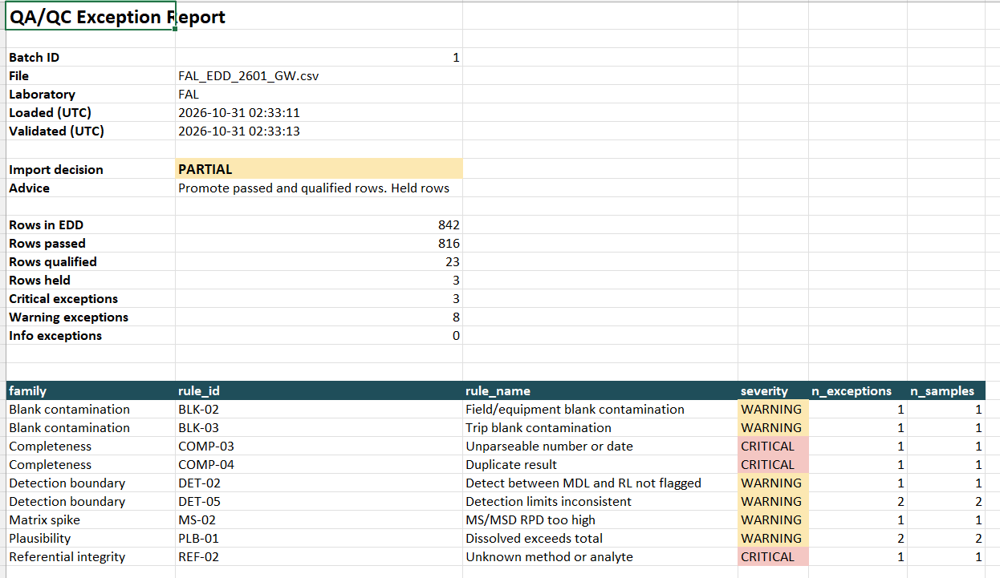

#### Contact Information
* priyankasag10@gmail<!-- -->.com
* Reading, UK
* [Linkedin](https://www.linkedin.com/in/priyanka-sagwekar-aa755a117/)

## Check out my Projects!

### Project 1
<section class="project">
  <h2>Automated Environmental QA/QC &amp; EDD Validation Engine</h2>
  
<em>Python · SQL Server · pandas · Excel reporting · GIS</em>

  

    Laboratory data must be checked before it reaches a project database. This is a pipeline
    that automates those checks. It loads lab Electronic Data Deliverables (EDDs) from CSV or
    Excel into a SQL Server staging area. It then runs 36 automated QA/QC rules and writes a
    formatted Excel exception report for each file. Only data that passes is promoted to the
    master database, with standard validation qualifiers attached.
  

  <h3>Key features</h3>
  <ul>
    <li>Checks holding times, blank contamination, surrogate and spike recoveries, field duplicates and detection limits.</li>
    <li>Also checks cooler temperatures, borehole depths, well screens and links to reference data.</li>
    <li>Keeps every limit in database tables, so a data manager can change rules without touching code.</li>
    <li>Uses a data model based on EQuIS, with a stored procedure that promotes clean data in one transaction.</li>
    <li>Produces an import decision for each file: go, partial or no-go.</li>
    <li>Exports each location's QC status in British National Grid coordinates, ready for ArcGIS.</li>
  </ul>

  <h3>Results</h3>
  <ul>
    <li>Tested on six simulated lab files for a fictional UK site, covering groundwater and soil.</li>
    <li>Caught all 53 deliberately injected errors, with zero false alarms on clean data.</li>
    <li>Correctly rejected one badly broken file and partly promoted the other five.</li>
    <li>Covered by 17 automated tests, including an end-to-end SQL Server test.</li>
  </ul>

  
Exception Report Summary Sheet after QA/QC Checks

  
  
<a href="https://github.com/your-username/your-repo">View the code on GitHub</a>

</section>

### Project 2
**Interactive AGS 4 Borehole & Groundwater Log Profiler**
  **Target Skills:** AGS Data Formats, Contaminated Land/Hydrogeology context, Python (python-ags4), Streamlit/Dash
  **The Concept:** Build a lightweight web application that allows ground engineers to upload a raw .ags file and instantly see structured data groups and borehole stratigraphy.

### Project 3
**Automated Contaminated Land GIS & Screen-Limit Dashboard**
  **Target Skills:** GIS/Spatial Visualization, Regulatory Screening, Dashboarding
  **The Concept:** An automated dashboard that flags statutory environmental guideline exceedances (e.g., UK Soil Guideline Values or EA Groundwater protection targets) and maps them spatially.

### Project 4
**ArcGIS Geoprocessing of Technical data**
  **Target Skills:** Python, AGS4 file processing, ArcGIS, Geotechnical data understanding
  **The Concept:** Synthetic AGS4 dataset modeling a benzene leak scenario across five monitoring locations at the refinery. 3D cross-sections and subsurface soil profiles in ArcGIS Pro using this AGS data

## Certifications
[Fundamentals of ArcGIS](https://www.coursera.org/learn/gis?specialization=gis) by University of California, Davis on Coursera  
Specialisation in Progress.
